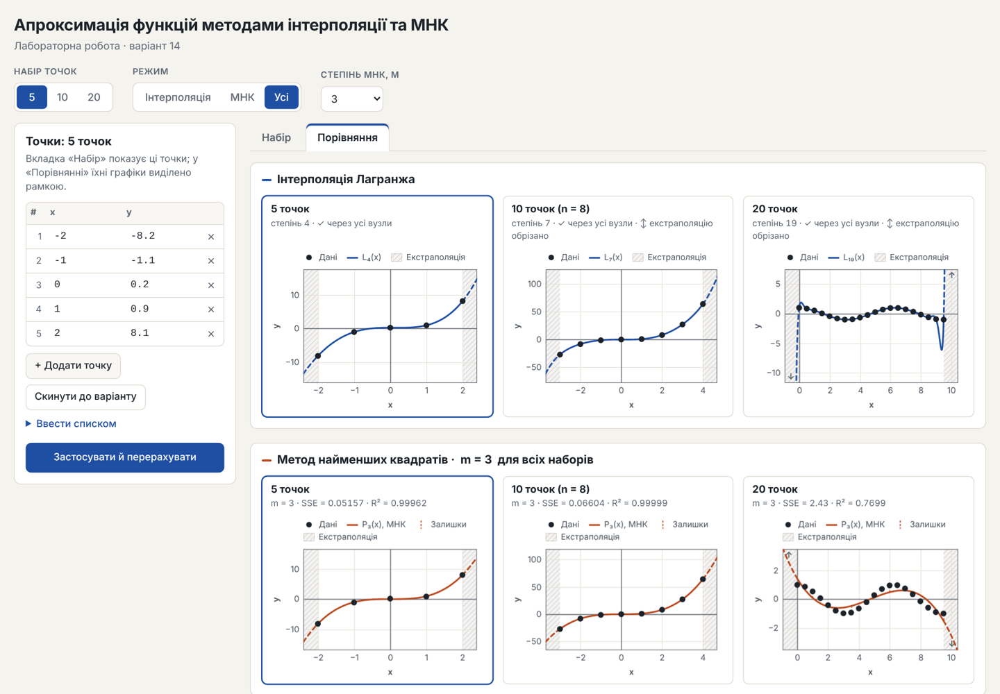

# Апроксимація функцій: інтерполяція та МНК

Лабораторна робота, **варіант 14**. Односторінковий вебзастосунок на чистому JavaScript і HTML5 Canvas,
без бібліотек: будує інтерполяційні поліноми Лагранжа й Ньютона та апроксимацію методом найменших
квадратів (МНК) для трьох наборів точок, показує залишки, таблицю поділених різниць і покрокову анімацію.



## Можливості

- **Інтерполяція.** Поліном Лагранжа (модифікована барицентрична форма) і поліном Ньютона з таблицею
  поділених різниць; перевірка, що поліном проходить через усі вузли.
- **МНК** степеня m = 1…4 через QR-розклад Хаусхолдера (без нормальних рівнянь AᵀA), з нормалізацією
  x → t ∈ [−1, 1]. Метрики: SSE, RMSE, max |r|, R²; таблиця залишків.
- **Графіки на Canvas:** автомасштаб (+10 %), сітка, легенда з перемиканням серій, підказки з похибкою
  в точці, затінена зона екстраполяції, діаграма залишків. Чіткі на HiDPI, адаптивні, світла й темна тема.
- **Дві вкладки:** «Набір» — великі графіки активного набору й таблиці; «Порівняння» — 6 полотен
  (Лагранж і МНК для 5, 8, 20 точок) зі спільним m.
- **Перемикач** «Інтерполяція / МНК / Усі» і набору 5 / 10 / 20.
- **Ручне введення** точок (таблиця або список `x y` / `x;y`) з валідацією: числа, різні x, від 2 до 50 точок.
- **Покрокова анімація** з кнопками «Старт / Пауза / Скидання»: вузли Лагранжа додаються по одному,
  поліном МНК «виростає» з y = ȳ, залишки з'являються по черзі; межі осей підлаштовуються плавно.

## Запуск

Сервер і збирання не потрібні — достатньо браузера:

1. Завантажте або клонуйте репозиторій.
2. Відкрийте **`index.html`** подвійним кліком (працює через `file://`).
3. Тести — **`tests.html`** так само, подвійним кліком.

Скрипти підключено звичайними тегами `<script>` (без ES-модулів, бо `import` не працює з `file://`);
модулі спілкуються через спільний простір імен `window.Approx`. Перевірено в Chromium; код використовує
лише стандартні API (Canvas 2D, ResizeObserver, requestAnimationFrame), підтримувані актуальними Firefox, Edge і Safari.

## Дані варіанту 14

| Набір | Точок | Характер |
| --- | --- | --- |
| «5 точок» | 5 | ≈ y = x³ із шумом, x = −2…2 |
| «10 точок» | 8 (за варіантом) | ≈ y = x³ із шумом, x = −3…4 |
| «20 точок» | 20 | косинусоїда y ≈ cos x, x = 0…9.5, крок 0.5 |

## Структура

```
approx-lab/
├── index.html          # сторінка застосунку
├── tests.html          # тест-раннер у браузері + таблиця порівняння МНК
├── style.css           # стилі, світла/темна тема, кольори графіків (CSS-змінні)
├── js/                 # порядок підключення важливий:
│   ├── data.js         # 1. набори точок варіанту
│   ├── lagrange.js     # 2. Лагранж, Ньютон, поділені різниці, перевірка вузлів
│   ├── lsq.js          # 3. МНК: дизайн-матриця, QR Хаусхолдера, метрики
│   ├── validation.js   # 4. розбір і перевірка введених точок
│   ├── animation.js    # 5. requestAnimationFrame, Timeline, покрокова демонстрація
│   ├── plot.js         # 6. графіки Plot / ResidualPlot, автомасштаб, легенда, підказки
│   └── main.js         # 7. стан, обробники подій, вкладки, таблиці
└── docs/
    ├── diagrams.md     # sequence-діаграма і діаграма компонентів (Mermaid)
    ├── *.mmd, *.svg    # ті самі діаграми: вихідний код і рендер
    ├── commit-plan.md  # план комітів за етапами V-моделі
    └── screenshot-*.png
```

Детальніше — у [docs/diagrams.md](docs/diagrams.md).

## Чисельні методи

| Задача | Реалізація | Чому так |
| --- | --- | --- |
| Лагранж | p(t) = ℓ(t)·Σ wₖyₖ/(t − tₖ) — модифікована барицентрична форма | O(n) на точку замість O(n²), обернено стійка; на 20 точках похибка 2.7·10⁻¹³ проти точної арифметики |
| Ньютон | поділені різниці + схема Горнера, вузли в порядку Лейї | при зростаючому порядку похибка росте з n (на 50 точках — до 41 у вузлах), з порядком Лейї — 4·10⁻¹⁵ |
| МНК | дизайн-матриця в t = (x − c)/h, QR Хаусхолдера, зворотна підстановка | cond(AᵀA) = cond(A)²; нормалізація тримає cond(A) = 17 для m = 4 навіть при x ≈ 1000 (без неї — 2.3·10²²) |

Ефект Рунге на 20 рівновіддалених вузлах — властивість задачі: L₁₉ проходить через усі вузли, але
біля x ≈ 9.37 відхиляється від cos x на 5.1. На графіку це видно, вісь y враховує коливання всередині
відрізка, а хвости екстраполяції обрізаються зі стрілкою ↑/↓.

## Тестування

`tests.html` — 26 автоматичних перевірок, кожна показує фактичну похибку й допуск:

- Лагранж проходить через усі вузли; базис Lₖ(xⱼ) = δₖⱼ;
- Ньютон збігається з Лагранжем у вузлах і між ними; таблиця поділених різниць = ручний розрахунок;
- МНК при m = n − 1 збігається з інтерполяцією (m = 4, 7, 19);
- точні дані y = x³ при m = 3 дають залишки ≈ 0 (зокрема для x ≈ 1000);
- залишки ортогональні стовпцям дизайн-матриці (Aᵀr ≈ 0);
- валідація відхиляє однакові x (у тому числі `1`, `1.0`, `1,0`), нечислові значення, менше 2 точок;
- регресійні тести на дефекти, знайдені під час рев'ю (сталі дані, R², reduced motion, Ньютон на 50 точках).

Нижче на сторінці — таблиця порівняння МНК для 5 / 8 / 20 точок і m = 2, 3, 4 (RMSE, max |r|, R², час).

## Методологія

Обрано **V-модель**: вимоги чіткі й стабільні, виконавець один, термін ~2 тижні, а результат легко
перевірити числами. Кожному етапу розробки (ліва гілка «V») відповідає етап перевірки (права гілка):

| Розробка | Перевірка |
| --- | --- |
| Технічне завдання | Приймальне тестування за критеріями ТЗ |
| Архітектура (модулі, порядок скриптів) | Інтеграційна перевірка інтерфейсу |
| Модулі обчислень (Лагранж, Ньютон, МНК) | Модульні тести в `tests.html` |

Agile дав би гнучкість, яка тут не потрібна, а Spiral розв'язує проблему ризиків, якої немає.
Слабке місце V-моделі — пізнє виявлення помилок — закрито тим, що кожен модуль тестується одразу
після написання. Етапи й повідомлення комітів — у [docs/commit-plan.md](docs/commit-plan.md).

## Обмеження

- Степінь МНК у інтерфейсі — 1…4 (для косинусоїди на 20 точках добре наближення дає лише m ≈ 7).
- Перемикання серій у легенді — лише мишею.
- Покрокова анімація запускається користувачем і не вимикається налаштуванням «зменшити анімацію»
  (анімації появи — вимикаються).

---

Навчальний проєкт, 4 курс, спеціальність «Інженерія програмного забезпечення».
